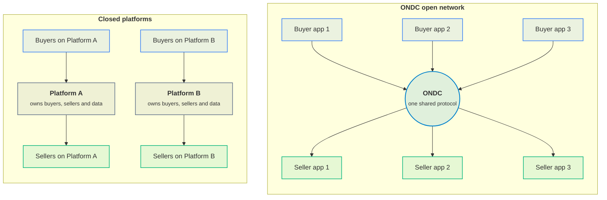
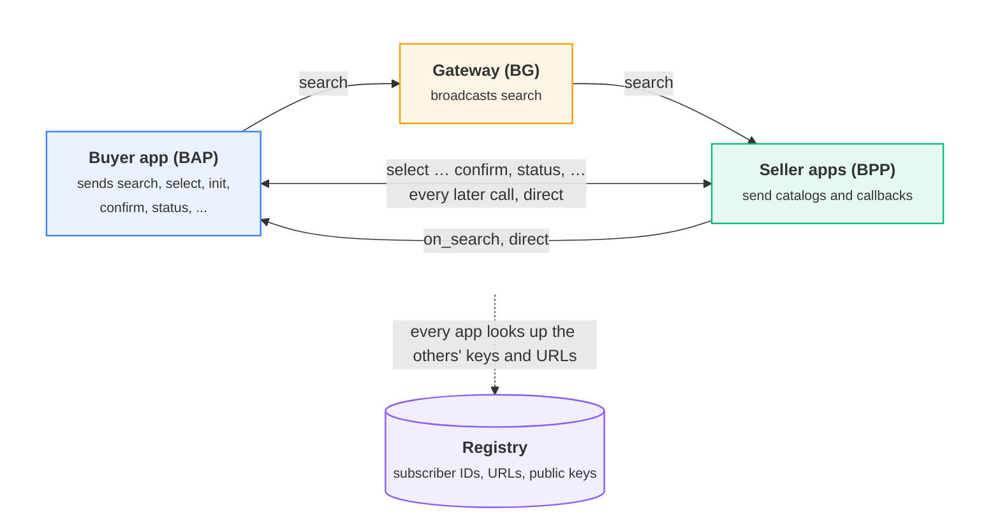

# ONDC

> A short introduction to the Open Network for Digital Commerce for developers who are new to ONDC.

---

## 1. What is ONDC?

Traditional e-commerce platforms are **closed**. A seller on Platform A is only visible to buyers on Platform A; to reach buyers elsewhere, it must integrate with every other platform separately.

**ONDC (Open Network for Digital Commerce)** is an open, decentralized network backed by the Government of India's Department for Promotion of Industry and Internal Trade (DPIIT). It separates **buyer applications** from **seller applications**, so any buyer app can discover and transact with any seller app on the network. No single entity owns the transaction, the data, or the relationship.

Think of it as **UPI for e-commerce**: just as UPI lets any bank's app pay any other bank's app, ONDC lets any buyer app buy from any seller app. Like email, where Gmail and Outlook users can write to each other because both speak SMTP, every participant speaks one shared protocol, based on [Beckn](/developer-guide/docs/protocol).

On a closed platform, a seller reaches only that platform's buyers. On ONDC, every buyer app can reach every seller app.

---

## 2. Key Concepts

| Concept | What It Is |
| --- | --- |
| **Network Participant (NP)** | Any entity registered on the network. Each NP has a unique **subscriber ID** (a domain name like `example-buyer.com`) and is listed in the Registry. |
| **BAP** (Beckn Application Platform) | The **buyer-side** app. It sends requests for consumers: search, order, status. Examples: a shopping, food or mobility app. |
| **BPP** (Beckn Provider Platform) | The **seller-side** app. It returns catalogs, confirms orders and sends fulfillment updates. Examples: a store or inventory platform, a logistics provider. |
| **Gateway (BG)** | Broadcasts a BAP's `search` to the relevant BPPs. It takes part **only** in discovery; everything after that is direct between BAP and BPP. |
| **Registry** | The trust anchor. It stores every NP's subscriber ID, URLs, supported domains and public keys, so a receiver can verify who sent a request. |
| **Domain** | A vertical with its own code and rules, for example `ONDC:RET10` (Grocery), `ONDC:LOG10` (Logistics) or `ONDC:FIS12` (Credit). The core protocol is the same in every domain. |

A single company can act as both a BAP and a BPP, but they are separate roles with separate subscriber IDs.

How the participants connect:

> **Colour key**, the same in every diagram of this guide: **blue** = buyer app (BAP), **green** = seller app (BPP), **amber** = Gateway, **violet** = Registry.

The Gateway is used only for `search`. Every other call goes directly between the buyer app and the seller app, and every app checks the Registry to find the other's URL and verify its signature.

---

## 3. Where to Go Next

| To Learn About | See |
| --- | --- |
| How a complete transaction works, the protocol architecture, subscription and signing | [Protocol](/developer-guide/docs/protocol) |
| Every API, the `context` object and payload structure | [API Reference](/developer-guide/docs/api-reference) |
| Creating and verifying the `Authorization` header | [Signing & Verification](/developer-guide/auth-tools) |
| Signing and encryption keys | [Keys & Encryption](/developer-guide/docs/keys-and-encryption) |
| The Registry, lookup and the Gateway | [Registry & Gateway](/developer-guide/docs/registry-gateway) |
| Pushing transaction logs to ONDC | [Network Observability](/developer-guide/docs/network-observability) |
| City codes for `context.city` | [City & State Codes](/developer-guide/docs/city-state-codes) |
| `NACK` error codes | [Core Error Codes](/developer-guide/docs/error-codes) |
| Flows, payloads and rules of a specific domain | **Explore by Domain** |

---

## 4. Developer Resources

| Resource | URL |
| --- | --- |
| **ONDC GitHub (Official)** | [github.com/ONDC-Official](https://github.com/ONDC-Official) |
| **Protocol Specs** | [github.com/ONDC-Official/automation-specifications](https://github.com/ONDC-Official/automation-specifications) |
| **Network Extension Layer** | [github.com/ONDC-Official/protocol-network-extension](https://github.com/ONDC-Official/protocol-network-extension) |
| **Signing & Verification** | [developer-docs/registry/signing-verification.md](https://github.com/ONDC-Official/developer-docs/blob/main/registry/signing-verification.md) |
| **ONDC Portal** | [portal.ondc.org](https://portal.ondc.org) |

---

## 5. Glossary

| Term | Definition |
| --- | --- |
| **BAP** | Beckn Application Platform — the buyer-side application |
| **BPP** | Beckn Provider Platform — the seller-side application |
| **BG** | Beckn Gateway — broadcasts search requests during discovery |
| **NP** | Network Participant — any entity registered on the ONDC network |
| **Registry** | Central lookup service storing NP metadata and public keys |
| **Context** | Metadata envelope carried by every API request and callback |
| **Transaction ID** | Unique identifier that ties together all API calls of one transaction |
| **Message ID** | Unique identifier of one request and its callback (for example `search`–`on_search`); every unsolicited callback, such as `on_status`, has its own |
| **ACK** | Positive acknowledgment — request accepted for processing |
| **NACK** | Negative acknowledgment — request rejected with error details |
| **IGM** | Issue & Grievance Management — APIs for complaints and their resolution |
| **RSF** | Reconciliation & Settlement Framework — APIs for financial reconciliation |
| **NO** | Network Observability — transaction log monitoring framework |
| **Ed25519** | Elliptic curve signing algorithm used to sign requests |
| **X25519** | Elliptic curve algorithm used for encryption between NPs, where a use case requires it |
| **Subscriber ID** | The FQDN-based unique identifier of a Network Participant |
| **Beckn** | The open-source decentralized commerce protocol that ONDC is built on |
