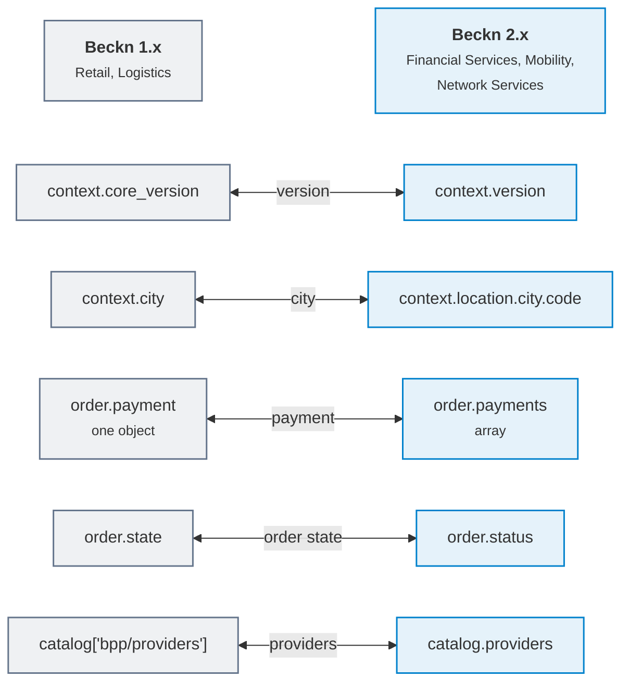
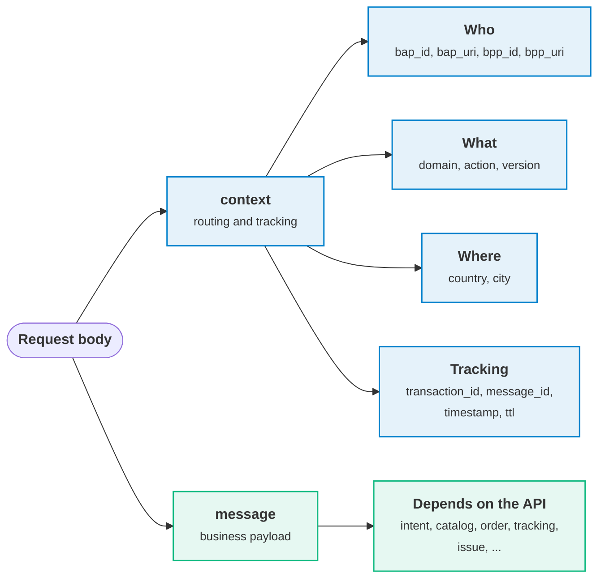
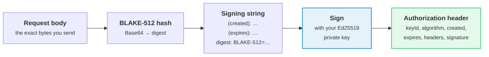
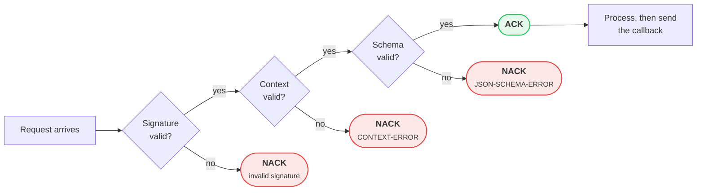
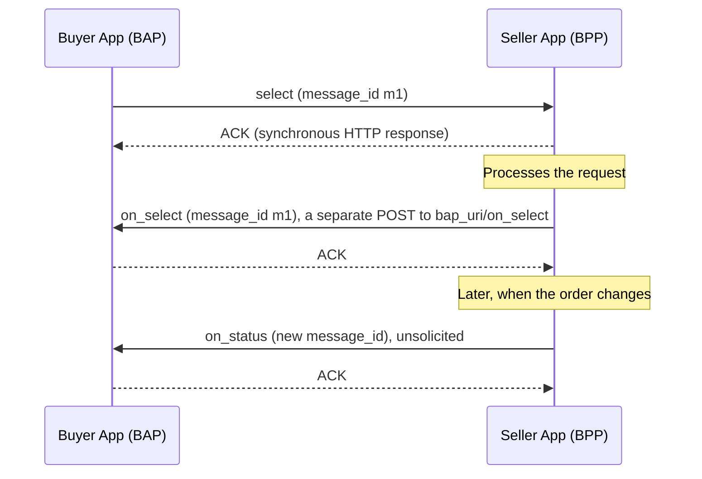
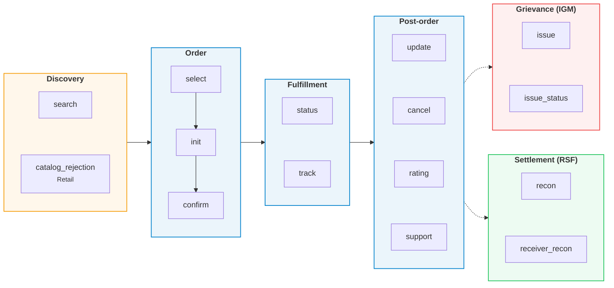
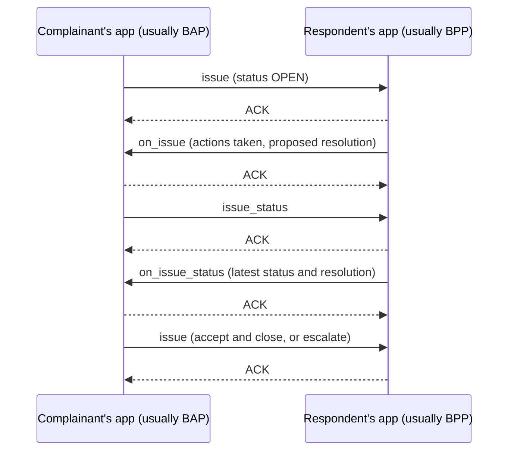
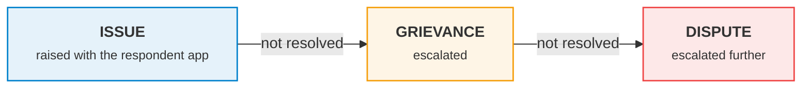
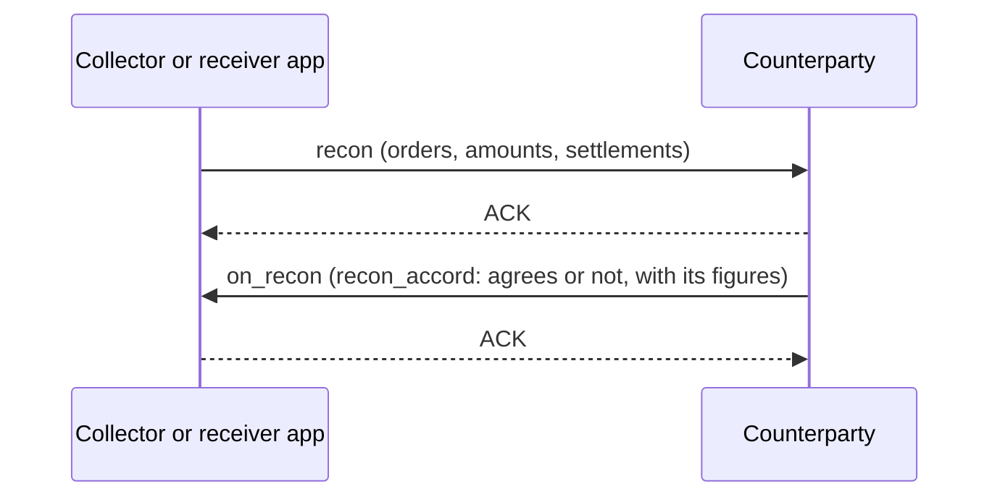

# ONDC API Reference

> Every ONDC API endpoint, the request and response envelope, and every field of the `context` object, with the message structure of each API.

---

## Overview

Every interaction on ONDC is an HTTP `POST` of a JSON payload from one network participant to another. This page covers what is the same across the whole network:

- How a call is made: the endpoint URL, headers, request envelope and the synchronous `ACK` / `NACK` response.
- The **`context`** object, field by field, in both formats used on the network.
- **Every API endpoint**: who sends it, who receives it, and what its `message` carries.
- The common message objects (`order`, `provider`, `items`, `fulfillments`, `payment`, `quote`, and others).
- Issue and Grievance Management (IGM), Reconciliation and Settlement (RSF), and the Registry lookup.

Each domain adds its own fields, codes and rules on top of this (for example loan details in Credit or package dimensions in Logistics). Those are documented per use case under **Explore by Domain**, in each API's attribute list, validations and example payloads.

### Two Payload Formats

ONDC domains are built on two versions of the Beckn core specification. They share the same APIs and flow, but differ in a few field names. Check which one your domain uses before you build.

| | Beckn 1.x format | Beckn 2.x format |
| --- | --- | --- |
| **Domains** | Retail (`ONDC:RET10` – `ONDC:RET18`, eB2B), Logistics (`ONDC:LOG10`, `ONDC:LOG11`, `nic2004:60232`) | Financial Services (`ONDC:FIS10` – `ONDC:FIS14`), Mobility and Travel (`ONDC:TRV10` – `ONDC:TRV14`), Network Services (`ONDC:NTS10`) |
| **Version field** | `context.core_version`, e.g. `"1.2.5"` | `context.version`, e.g. `"2.0.3"` |
| **Country and city** | `context.country`, `context.city` | `context.location.country.code`, `context.location.city.code` |
| **Payment** | `order.payment` (one object) | `order.payments` (array) |
| **Order state** | `order.state` | `order.status` |
| **Catalog providers** | `catalog["bpp/providers"]` | `catalog.providers` |

The same field in each format:



The version value always matches the domain specification version you implement. For example, Grocery 1.2.5 sends `core_version: "1.2.5"`, and Credit 2.0.3 sends `version: "2.0.3"`.

---

## 1. How Every API Call Works

### 1.1 Endpoint URL

The endpoint is the receiver's subscriber URL followed by the API name:

| Sending to | URL | Example |
| --- | --- | --- |
| A seller app (BPP) | `context.bpp_uri` + `/` + action | `https://sellerNP.com/ondc/select` |
| A buyer app (BAP) | `context.bap_uri` + `/` + action | `https://buyerNP.com/ondc/on_select` |
| The Gateway (`search` only) | The Gateway's subscriber URL + `/search` | Looked up from the [Registry](/developer-guide/docs/registry-gateway) |

`bap_uri` and `bpp_uri` are the subscriber URLs registered for each participant in the ONDC Registry.

### 1.2 Request Envelope

Every request and every callback has the same two top-level keys:

```json
{
    "context": {
        "domain": "ONDC:RET10",
        "action": "select",
        "...": "..."
    },
    "message": {
        "order": {
            "...": "..."
        }
    }
}
```

| Key | Required | What It Carries |
| --- | --- | --- |
| `context` | Yes | Routing and tracking information: domain, action, sender and receiver, transaction and message IDs, time and validity. Described in [section 2](#2-the-context-object). |
| `message` | Yes (`catalog_rejection` uses `message.errors`) | The business payload. Its structure depends on the API. Described in [section 3](#3-api-endpoints). |



### 1.3 Headers

| Header | When | Value |
| --- | --- | --- |
| `Content-Type` | Every request | `application/json` |
| `Authorization` | Every request and callback | The sender's signature over the exact request body: `Signature keyId="{subscriber_id}\|{unique_key_id}\|ed25519",algorithm="ed25519",created="…",expires="…",headers="(created) (expires) digest",signature="…"` |
| `X-Gateway-Authorization` | `search` forwarded by the Gateway to a BPP | The Gateway's own signature, in the same format |

How the `Authorization` header is built:



The receiver verifies the signature with the sender's public key from the Registry before processing. Sign the body exactly as you send it: any change after signing, including whitespace or key order, makes the signature invalid. See [Signing & Verification](/developer-guide/auth-tools) to create and verify headers, and [Keys & Encryption](/developer-guide/docs/keys-and-encryption) for key formats.

### 1.4 Synchronous Response: ACK and NACK

The receiver answers every request at once, before doing the business processing. The answer only says whether the request was **accepted** (valid signature, context and schema). The business result comes later, in the callback.



**ACK:**

```json
{
    "message": {
        "ack": { "status": "ACK" }
    }
}
```

**NACK:**

```json
{
    "message": {
        "ack": { "status": "NACK" }
    },
    "error": {
        "type": "CONTEXT-ERROR",
        "code": "20002",
        "path": "context.timestamp",
        "message": "Stale request"
    }
}
```

| Field | Required | Type | Description |
| --- | --- | --- | --- |
| `message.ack.status` | Yes | `ACK` \| `NACK` | `ACK` if the request passed validation; otherwise `NACK`. |
| `message.ack.tags` | No | array | Any additional information sent with the acknowledgement. |
| `error.type` | Yes, on errors | `CONTEXT-ERROR` \| `CORE-ERROR` \| `DOMAIN-ERROR` \| `JSON-SCHEMA-ERROR` | Which layer the request failed in. |
| `error.code` | Yes, on errors | string | ONDC error code. See [Core Error Codes](/developer-guide/docs/error-codes) and each use case's **Error Codes** tab. |
| `error.path` | No | string | Path to the failing field. Used for schema validation errors. |
| `error.message` | No | string | Human-readable description of the error. |

The same `error` object can be sent inside a callback (for example an `on_select` with an error) when a request was accepted but could not be fulfilled.

### 1.5 Request, Callback and Unsolicited Calls

ONDC is asynchronous. For every request API (`search`, `select`, `init` …) there is a callback API with an `on_` prefix (`on_search`, `on_select`, `on_init` …).



- **Same `transaction_id`** for every call in one transaction, from `search` through the end of the order (`status`, `update`, `cancel`, `track`).
- **Same `message_id`** in a request and its callback. Use it to match each callback to its request and to drop duplicates.
- **Unsolicited callbacks:** the BPP can send `on_status`, `on_update` and `on_cancel` without a request, for example when an order is packed, picked up or delivered. These carry a **new** `message_id`.
- **`ttl`:** the request is valid for `context.ttl` after `context.timestamp`. A callback should arrive within that window, and a request received after it has expired is rejected.
- **One request, many callbacks:** a single `search` can get `on_search` responses from many BPPs, each with the same `transaction_id` and `message_id` but a different `bpp_id`.

### 1.6 Who Calls Whom

| API | Sender → Receiver | Notes |
| --- | --- | --- |
| `search` | BAP → Gateway → BPPs | Broadcast to the matching seller apps through the Gateway. |
| `on_search` | BPP → BAP | Sent directly to `bap_uri`, not through the Gateway. |
| `catalog_rejection` | BAP → BPP | Retail: reports errors found in a received catalog. |
| `select`, `init`, `confirm` | BAP → BPP | Direct, using `bpp_uri` from `on_search`. |
| `on_select`, `on_init`, `on_confirm` | BPP → BAP | |
| `status`, `track`, `update`, `cancel` | BAP → BPP | |
| `on_status`, `on_track`, `on_update`, `on_cancel` | BPP → BAP | `on_status`, `on_update` and `on_cancel` can also be unsolicited. |
| `rating`, `support` | BAP → BPP | |
| `on_rating`, `on_support` | BPP → BAP | |
| `issue`, `issue_status` | Complainant's app → respondent's app | Usually BAP → BPP. |
| `on_issue`, `on_issue_status` | Respondent's app → complainant's app | Usually BPP → BAP. |
| `recon` / `receiver_recon` | Collector or receiver app → counterparty | RSF only. |
| `on_recon` / `on_receiver_recon` | Counterparty → sender | RSF only. |

---

## 2. The Context Object

`context` is the first key of every request and callback. It tells the receiver which domain and API this is, who sent it, where to reply, and which transaction it belongs to. Most errors caused by a bad `context` are rejected with a `NACK` before the message is read.

### 2.1 Beckn 1.x Context (Retail and Logistics)

```json
"context": {
    "domain": "ONDC:RET10",
    "action": "select",
    "country": "IND",
    "city": "std:011",
    "core_version": "1.2.5",
    "bap_id": "buyerNP.com",
    "bap_uri": "https://buyerNP.com/ondc",
    "bpp_id": "sellerNP.com",
    "bpp_uri": "https://sellerNP.com/ondc",
    "transaction_id": "3cd7243a-eef8-42e1-8d12-9c76eab6fcea",
    "message_id": "835d5463-3dc6-4e69-a4c9-d8cc7e4e2521",
    "timestamp": "2026-09-02T14:01:05.738Z",
    "ttl": "PT30S"
}
```

| Field | Required | Type | Set by | Description | Example |
| --- | --- | --- | --- | --- | --- |
| `domain` | Yes | string | BAP | Domain code of the transaction. The BPP copies it into every callback. | `ONDC:RET10` |
| `action` | Yes | string | Sender | The API being called. Must match the endpoint path. | `select` |
| `country` | Yes | string | BAP | Country code, ISO 3166-1 alpha-3. | `IND` |
| `city` | Yes | string | BAP | City code: `std:` followed by the city's STD code, with its leading `0`. In `search`, `*` searches every city. See [City & State Codes](/developer-guide/docs/city-state-codes). | `std:080` |
| `core_version` | Yes | string | Sender | Version of the domain specification being used. | `1.2.5` |
| `bap_id` | Yes | string | BAP | Subscriber ID of the buyer app, normally its fully qualified domain name. | `buyerNP.com` |
| `bap_uri` | Yes | string (URI) | BAP | Subscriber URL of the buyer app, where callbacks are sent. Must be on the same domain as `bap_id`. | `https://buyerNP.com/ondc` |
| `bpp_id` | All APIs except `search` | string | BPP | Subscriber ID of the seller app. Absent in `search`, because the BAP does not know the seller yet; set by the BPP from `on_search` onwards. | `sellerNP.com` |
| `bpp_uri` | All APIs except `search` | string (URI) | BPP | Subscriber URL of the seller app, where requests are sent. Must be on the same domain as `bpp_id`. | `https://sellerNP.com/ondc` |
| `transaction_id` | Yes | string | BAP | Created by the BAP on `search` and kept in every call of the transaction, from `search` through `confirm` and all post-order calls. | UUID |
| `message_id` | Yes | string | Sender of the request | Unique for each request; the callback repeats the request's `message_id`. Unsolicited callbacks use a new one. | UUID |
| `timestamp` | Yes | string (date-time) | Sender | When the request was created, in RFC 3339 UTC format with milliseconds. | `2026-09-02T14:01:05.738Z` |
| `ttl` | No | string (ISO 8601 duration) | Sender | How long the message is valid after `timestamp`. In Retail the outer limit is `PT30S` (30 seconds) for `search`, `select`, `init`, `confirm`, `status`, `track`, `cancel`, `update`, `rating` and `support`; a buyer app can use a shorter value, never longer. | `PT30S` |
| `key` | No | string | Sender | The sender's encryption public key, where a use case needs encryption. | |

### 2.2 Beckn 2.x Context (Financial Services, Mobility, Network Services)

```json
"context": {
    "domain": "ONDC:FIS12",
    "location": {
        "country": { "code": "IND" },
        "city": { "code": "*" }
    },
    "version": "2.0.3",
    "action": "search",
    "bap_id": "pramaan.ondc.org",
    "bap_uri": "https://pramaan.ondc.org/beta/staging/mock/buyer",
    "transaction_id": "04b2dc1f-1e96-43e9-8ea6-604bbf489560",
    "message_id": "89df9a22-04ee-4399-8a7b-0182cd2b66df",
    "timestamp": "2025-08-18T14:20:10.420Z",
    "ttl": "PT10M"
}
```

| Field | Required | Type | Set by | Description | Example |
| --- | --- | --- | --- | --- | --- |
| `domain` | Yes | string | BAP | Domain code of the transaction. | `ONDC:FIS12` |
| `action` | Yes | string | Sender | The API being called. | `search` |
| `location` | Yes | object | BAP | Where the transaction takes place. Set by the BAP in `search`; the BPP carries it forward in its callbacks. | |
| `location.country.code` | Yes | string | BAP | Country code, ISO 3166. | `IND` |
| `location.city.code` | Yes | string | BAP | City code, in the same `std:` format as above. In `search`, `*` covers every city where the service is offered. | `std:080` or `*` |
| `version` | Yes | string | Sender | Version of the domain specification being used. | `2.0.3` |
| `bap_id` | Yes | string | BAP | Subscriber ID of the buyer app. | `buyerNP.com` |
| `bap_uri` | Yes | string (URI) | BAP | Subscriber URL of the buyer app, where callbacks are sent. | `https://buyerNP.com/ondc` |
| `bpp_id` | All APIs except `search` | string | BPP | Subscriber ID of the seller app. | `sellerNP.com` |
| `bpp_uri` | All APIs except `search` | string (URI) | BPP | Subscriber URL of the seller app, where requests are sent. | `https://sellerNP.com/ondc` |
| `transaction_id` | Yes | string | BAP | Created on `search`; it identifies one user session and stays the same in every call of the transaction. | UUID |
| `message_id` | Yes | string | Sender of the request | Same in a request and its callback; use it to discard duplicates. | UUID |
| `timestamp` | Yes | string (date-time) | Sender | When the request was created, RFC 3339. | `2025-08-18T14:20:10.420Z` |
| `ttl` | Yes | string (ISO 8601 duration) | Sender | How long the message is valid after `timestamp`. Each domain sets its values per API. | `PT30S`, `PT10M` |

### 2.3 Context Rules Across a Transaction

| Field | Rule |
| --- | --- |
| `domain`, `country` / `location.country.code` | Same in every call of the transaction. |
| `city` / `location.city.code` | `*` is allowed only in `search`. From `on_search` onwards it is the city of the order. |
| `core_version` / `version` | Same in every call; the BPP answers with the version it received. |
| `bap_id`, `bap_uri` | Same in every call. |
| `bpp_id`, `bpp_uri` | Absent in `search`; then the same in every call with that seller. |
| `transaction_id` | Same in every call of the transaction. A new `search` starts a new transaction. |
| `message_id` | New for every request, repeated in its callback, new for every unsolicited callback. |
| `action` | Always equal to the API name in the URL path. |
| `timestamp` | The time of this call. Not in the future, and not older than `ttl` when received. |

---

## 3. API Endpoints

### 3.1 Endpoint Map

All API endpoints used across the ONDC domain specifications, by stage:



Every request except `catalog_rejection` has an `on_` callback. Only `search` goes through the Gateway.

| Endpoint | Callback | Stage | Purpose | `message` (request) | `message` (callback) |
| --- | --- | --- | --- | --- | --- |
| `/search` | `/on_search` | Discovery | Find providers and items that match the buyer's intent | `intent` | `catalog` |
| `/catalog_rejection` | — | Discovery | Report errors in a received catalog (Retail) | `errors` | — |
| `/select` | `/on_select` | Order | Choose items and get a quote | `order` | `order` (with `quote`) |
| `/init` | `/on_init` | Order | Add billing, fulfillment and payment details; get final terms | `order` | `order` |
| `/confirm` | `/on_confirm` | Order | Place the order | `order` | `order` (with `id`) |
| `/status` | `/on_status` | Fulfillment | Get the latest state of an order | `order_id` | `order` |
| `/track` | `/on_track` | Fulfillment | Get live tracking for an order | `order_id` | `tracking` |
| `/update` | `/on_update` | Post-order | Change part of an active order | `update_target`, `order` | `order` |
| `/cancel` | `/on_cancel` | Post-order | Cancel an order | `order_id`, `cancellation_reason_id`, `descriptor` | `order` |
| `/rating` | `/on_rating` | Post-order | Rate an order, item, provider or agent | `ratings` | `feedback_form` |
| `/support` | `/on_support` | Post-order | Ask for support contact details | `support` | `support` |
| `/issue` | `/on_issue` | Grievance | Raise or update an issue (IGM) | `issue` | `issue` |
| `/issue_status` | `/on_issue_status` | Grievance | Get the latest status of an issue (IGM) | `issue_id` | `issue` |
| `/recon` | `/on_recon` | Settlement | Reconcile settlements (RSF 2.0) | `orders` | `orders` |
| `/receiver_recon` | `/on_receiver_recon` | Settlement | Reconcile an order book (RSF 1.0) | `orderbook` | `orderbook` |

Not every domain uses every API. For example, Logistics 1.2.5 (`ONDC:LOG10`, `ONDC:LOG11`) has no `select`, and several Financial Services and Mobility specifications have no `track`. The use case's **API Walkthrough** under Explore by Domain lists the exact calls for each flow.

### 3.2 Discovery

#### `search` → `on_search`

The buyer app states what the user wants; each matching seller app answers with its catalog.

**`search` message:**

| Field | Description |
| --- | --- |
| `intent` | What the buyer is looking for. |
| `intent.item` | An item, by `descriptor.name` (free text) or `id`. |
| `intent.category` | A category, by `id` (1.x) or `descriptor.code` (2.x). |
| `intent.provider` | A specific provider, by `id` or `descriptor`. |
| `intent.fulfillment` | Fulfillment type, and the `end.location` (GPS, area code) to serve. |
| `intent.payment` | Payment terms the buyer app offers, e.g. its finder fee in Retail (`@ondc/org/buyer_app_finder_fee_type`, `@ondc/org/buyer_app_finder_fee_amount`). |
| `intent.tags` | Extra parameters, for example the buyer app's terms (`BAP_TERMS`) or catalog requests. |

**`on_search` message:**

| Field | Description |
| --- | --- |
| `catalog` | The seller app's catalog. |
| `catalog["bpp/descriptor"]` (1.x) / `catalog.descriptor` (2.x) | Name, images and description of the seller app. |
| `catalog["bpp/fulfillments"]` (1.x) | Fulfillment types the seller app supports. |
| `catalog["bpp/providers"]` (1.x) / `catalog.providers` (2.x) | The providers (stores, lenders, operators), each with its `items`, `categories`, `locations`, `fulfillments`, `offers`, `payments` and `tags`. |

In Retail, a buyer app that finds errors in a catalog tells the seller app with `catalog_rejection`. It sends `message.errors`, a list of `{ type, code, message, path }`.

### 3.3 Ordering

#### `select` → `on_select`

The buyer chooses items. The seller app replies with a quote and the available fulfillments.

| API | `message.order` carries |
| --- | --- |
| `select` | `provider` (`id`, `locations`), `items` (`id`, `quantity`, `location_id`), `fulfillments` (`end.location`), `offers`, `payment`, `tags` |
| `on_select` | `provider`, `items`, `fulfillments` (with delivery options and timings), `quote` (price and breakup), `payment`, `offers` |

#### `init` → `on_init`

The buyer app sends billing, delivery and payment details. The seller app replies with the final terms.

| API | `message.order` carries |
| --- | --- |
| `init` | `provider`, `items`, `billing`, `fulfillments` (`end.location`, `end.contact`), `payment` / `payments`, `tags` |
| `on_init` | Everything from `init`, plus `quote`, `cancellation_terms` and the payment terms (collector, settlement details) |

#### `confirm` → `on_confirm`

The buyer app places the order. The seller app accepts it and returns the order ID.

| API | `message.order` carries |
| --- | --- |
| `confirm` | `id` (Retail: created by the buyer app), `state`, `provider`, `items`, `billing`, `fulfillments`, `quote`, `payment` / `payments`, `created_at`, `updated_at`, `tags` |
| `on_confirm` | The accepted order: `id`, `state` / `status`, `provider`, `items`, `quote`, `fulfillments` (with state), `payment` / `payments`, `cancellation_terms`, `documents`, `created_at`, `updated_at` |

### 3.4 Fulfillment and Post-Order

#### `status` → `on_status`

| API | `message` carries |
| --- | --- |
| `status` | `order_id`. Some 2.x domains also send `ref_id`. |
| `on_status` | The full `order` with its current `state` / `status`, `fulfillments[].state`, `payment` / `payments` and `documents` (such as invoices). Also sent unsolicited when the order changes state. |

#### `track` → `on_track`

| API | `message` carries |
| --- | --- |
| `track` | `order_id` |
| `on_track` | `tracking`: `id`, `url` (tracking page or feed), `location` (current GPS and time), `status` (`active` or `inactive`), `tags` |

#### `update` → `on_update`

| API | `message` carries |
| --- | --- |
| `update` | `update_target` (which part of the order changes, as defined by the domain, such as items, fulfillments, payments or billing) and `order` with `id` and the changed parts |
| `on_update` | The updated `order`. Also sent unsolicited, for example for a return or a refund. |

#### `cancel` → `on_cancel`

| API | `message` carries |
| --- | --- |
| `cancel` | `order_id`, `cancellation_reason_id` (a reason code from the domain's list) and, in some domains, `descriptor` (`code`, `name`) |
| `on_cancel` | The cancelled `order`, with `state` / `status`, `cancellation` (who cancelled and why), the revised `quote` and any refund. Sent unsolicited when the seller app cancels. |

#### `rating` → `on_rating`, `support` → `on_support`

| API | `message` carries |
| --- | --- |
| `rating` | `ratings`: a list of `{ rating_category, id, value }`, where the category is what is rated (for example order, item, provider or agent) |
| `on_rating` | `feedback_form`, if the seller app asks for more feedback |
| `support` | `support`: `order_id` or `ref_id`, and the buyer's `callback_phone` |
| `on_support` | `support`: the seller app's `phone`, `email` and `url` for this order |

---

## 4. Common Message Objects

These objects appear in many APIs. Domains add fields to them (in Retail, fields under the `@ondc/org/` prefix), and add their own codes in `tags`.

### 4.1 Order

| Field | Description |
| --- | --- |
| `id` | Unique ID of the order across the network. |
| `state` (1.x) / `status` (2.x) | Order state, for example `Created`, `Accepted`, `In-progress`, `Completed`, `Cancelled`. Each domain defines its list. |
| `provider` | The provider the order is placed with: `id`, `locations`. |
| `items` | Ordered items: `id`, `quantity`, `fulfillment_id`(s), `location_id`, `parent_item_id`. |
| `billing` | Billing details (see below). |
| `fulfillments` | How and where each part of the order is delivered (see below). |
| `quote` | The price and its breakup. |
| `payment` (1.x) / `payments` (2.x) | Payment terms and status. |
| `offers` | Offers applied to the order. |
| `cancellation_terms` | When the order can be cancelled and the fee at each fulfillment state. |
| `cancellation` | Who cancelled the order and the reason. |
| `documents` | Documents for the order, such as an invoice URL. |
| `created_at`, `updated_at` | RFC 3339 timestamps. |
| `tags` | Domain-specific tag groups. |

### 4.2 Provider and Item

| Object | Field | Description |
| --- | --- | --- |
| Provider | `id` | ID of the provider (store, lender, operator). |
| | `descriptor` | Name, images and descriptions. |
| | `locations` | Store or service locations: `id`, `gps`, `address`, `city`, `state`, `circle`, `time`. |
| | `categories`, `items`, `offers`, `fulfillments` | What the provider offers. |
| | `time` | Opening hours or availability. |
| | `creds` | Credentials such as licences. |
| | `ttl` | How long the catalog is valid, ISO 8601 duration (e.g. `P7D`). |
| | `tags` | Domain-specific tag groups (for example serviceability, timing). |
| Item | `id` | Most specific ID of the item, such as a SKU. |
| | `parent_item_id` | ID of the parent item, for variants and add-ons. |
| | `descriptor` | Name, code, images and descriptions. |
| | `price` | `currency` (ISO 4217, `INR`), `value`, and in catalogs `maximum_value`. |
| | `quantity` | Available, maximum or selected quantity. |
| | `category_id` / `category_ids` | Categories the item belongs to. |
| | `fulfillment_id` / `fulfillment_ids` | Fulfillments that can deliver it. |
| | `location_id` | Location it is sold from. |
| | `time` | Availability timing. |
| | `tags` | Domain-specific attributes. |

### 4.3 Fulfillment

| Field | Description |
| --- | --- |
| `id` | Reference to this fulfillment within the order. |
| `type` | How it is fulfilled. In Retail: `Delivery`, `Pickup` or `Delivery and Pickup`. Other domains define their own types. |
| `state` | Current fulfillment state, as `state.descriptor.code` (for example `Pending`, `Order-picked-up`, `Order-delivered`). |
| `start`, `end` | Pickup and drop: `location` (GPS, address, area code), `time` (range or timestamp), `contact`, `person`, `instructions`, `authorization` (such as an OTP). |
| `agent` | The delivery person or operator: name and phone. |
| `vehicle` | Vehicle details, where relevant. |
| `tracking` | Whether tracking is available for this fulfillment. |
| `tags` | Domain-specific details (for example routing, delays, return details). |

### 4.4 Payment

| Field | 1.x (`payment`) | 2.x (`payments[]`) |
| --- | --- | --- |
| Type | `type`: `ON-ORDER`, `ON-FULFILLMENT`, `POST-FULFILLMENT` | `type`: when the payment is made, for example `PRE-ORDER`, `ON-ORDER`, `ON-FULFILLMENT` or `POST-FULFILLMENT`. Some domains spell these with underscores (`ON_ORDER`); use the exact values of your domain specification. |
| Status | `status`: `PAID`, `NOT-PAID` | `status` |
| Collector | `collected_by`: `BAP` or `BPP` | `collected_by` |
| Payment link | `uri` (empty means payment offline), `tl_method` | `url` |
| Transaction details | `params`: `amount`, `currency`, `transaction_id`, `transaction_status` | `params`: `amount`, `currency`, `transaction_id`, and bank details where the domain needs them |
| Settlement terms | `@ondc/org/buyer_app_finder_fee_type` (`Amount` / `Percent`), `@ondc/org/buyer_app_finder_fee_amount`, `@ondc/org/settlement_basis`, `@ondc/org/settlement_window`, `@ondc/org/withholding_amount`, `@ondc/org/settlement_details` | `tags`, for example `BUYER_FINDER_FEES` and `SETTLEMENT_TERMS` |

### 4.5 Quote, Billing and Tags

| Object | Field | Description |
| --- | --- | --- |
| Quote | `price` | Total: `currency`, `value`. |
| | `breakup` | Line items: each with an item or charge ID, a title, a type (item, delivery, packing, tax, discount and others defined by the domain) and a `price`. |
| | `ttl` | How long the quote is valid, ISO 8601 duration. |
| Billing | `name`, `phone`, `email` | Billing contact. |
| | `address` | Billing address. |
| | `tax_number` | Tax ID, such as a GSTIN. |
| | `created_at`, `updated_at` | Timestamps. |
| Tag group | `descriptor.code` (2.x) / `code` (1.x) | Machine-readable name of the group, defined by the core specification, the domain or the network. |
| | `list` | The tags in the group, each with `descriptor.code` / `code` and `value`. |
| | `display` (2.x) | Whether the BAP should show the group to the user. |
| Descriptor | `name`, `code`, `short_desc`, `long_desc`, `images`, `additional_desc` | The name and description of any object. `code` is the machine-readable value. |

---

## 5. Issue and Grievance Management (IGM)

IGM APIs carry complaints about orders between participants. They use the same envelope and `context` as the domain's other APIs.

| API | Sender → Receiver | `message` |
| --- | --- | --- |
| `issue` | Complainant's app → respondent's app | `issue` |
| `on_issue` | Respondent's app → complainant's app | `issue` |
| `issue_status` | Complainant's app → respondent's app (IGM 1.0) | `issue_id` |
| `on_issue_status` | Respondent's app → complainant's app | `issue` |



An issue that is not resolved can be escalated:



### 5.1 IGM 1.0 Issue Fields

| Field | Description |
| --- | --- |
| `id` | Unique ID of the issue. |
| `category` | What the issue is about: `ORDER`, `ITEM`, `FULFILLMENT`, `AGENT`, `PAYMENT` or `TRANSACTION`. |
| `sub_category` | Sub-category code, prefixed by its category: `ORD01`–`ORD03`, `ITM01`–`ITM04`, `FLM01`–`FLM07`, `FLM201`, `AGT01`–`AGT02`, `PMT01`–`PMT04`. |
| `issue_type` | `ISSUE`, escalated to `GRIEVANCE`, and further to `DISPUTE`. |
| `status` | `OPEN`, `CLOSED`, or `INFO_PROVIDED`. |
| `complainant_info` | Who raised it: `person` and `contact`. |
| `order_details` | The order: `id`, `state`, `items`, `fulfillments`, `provider_id`, `merchant_order_id`. |
| `description` | `short_desc`, `long_desc`, `additional_desc`, `images`. |
| `source` | `network_participant_id` and `type` (for example `CONSUMER`, `SELLER`, `INTERFACING-NP`). |
| `expected_response_time`, `expected_resolution_time` | ISO 8601 durations, for example `PT2H` and `P1D`. |
| `issue_actions` | History of actions: `complainant_actions` and `respondent_actions`. |
| `resolution_provider` | Who resolves it: `respondent_info`. |
| `resolution` | `short_desc`, `long_desc`, `action_triggered` (such as a refund or replacement), `refund_amount`. |
| `rating` | The complainant's rating of the resolution: `THUMBS-UP` or `THUMBS-DOWN`. |
| `created_at`, `updated_at` | Timestamps. |

### 5.2 IGM 2.0 Issue Fields

IGM 2.0 keeps one `issue` object and records every step as an action by an actor:

| Field | Description |
| --- | --- |
| `id`, `status`, `level` | Issue ID, current status, and level (for example `ISSUE`). |
| `descriptor` | `code` (issue code, such as `ITM004`), `short_desc`, `long_desc`, `additional_desc`, `images`, `media`. |
| `refs` | What the issue refers to: `ref_id` and `ref_type` (for example `ORDER`), with `tags`. |
| `actors` | Everyone involved: `id`, `type` (for example `CONSUMER`) and `info`. |
| `source_id`, `complainant_id`, `respondent_ids`, `resolver_ids` | Which actors raised, received and resolve the issue. |
| `actions` | Every step: `id`, `action_by`, `actor_details`, `descriptor` and `updated_at`. |
| `last_action_id` | ID of the latest action. |
| `expected_response_time`, `expected_resolution_time` | ISO 8601 durations. |
| `resolutions` | Proposed or agreed resolutions. |
| `created_at`, `updated_at` | Timestamps. |

The use case's API Walkthrough shows which IGM version each flow uses.

---

## 6. Reconciliation and Settlement (RSF)

The Reconciliation and Settlement Framework (`ONDC:NTS10`) lets the collector and receiver of a payment agree on what is owed for each order. It uses the Beckn 2.x `context`.



| API | Version | `message` |
| --- | --- | --- |
| `recon` → `on_recon` | RSF 2.0 | `orders`: each with `id`, `amount` (`currency`, `value`) and `settlements` (`id`, `payment_id`, `status`, `amount`, `commision`, `withholding_amount`, `tcs`, `tds`, `settlement_ref_no`, `updated_at`). `on_recon` adds `recon_accord` (whether the counterparty agrees) and `due_date`. |
| `receiver_recon` → `on_receiver_recon` | RSF 1.0 | `orderbook.orders`: each with `id`, `invoice_no`, `collector_app_id`, `receiver_app_id`, `state`, `provider`, `payment`, `withholding_tax_gst`, `withholding_tax_tds`, `deduction_by_collector`, `settlement_id`, `settlement_reference_no`, `recon_status`. `on_receiver_recon` returns `order_recon_status`, `counterparty_recon_status` and `counterparty_diff_amount`. |

---

## 7. Registry Lookup

Before calling another participant, look up its subscriber URL and public signing key in the Registry with `/v2.0/lookup`. This call is signed with the same `Authorization` header as the transaction APIs.

```bash
curl -X POST https://prod.registry.ondc.org/v2.0/lookup \
  -H "Content-Type: application/json" \
  -H "Authorization: Signature keyId=\"your-app.com|key123|ed25519\", ..." \
  -d '{
    "subscriber_id": "seller-app.com",
    "domain": "ONDC:RET10",
    "type": "BPP",
    "country": "IND"
  }'
```

| Environment | Endpoint |
| --- | --- |
| Pre-Production | `preprod.registry.ondc.org/v2.0/lookup` |
| Production | `prod.registry.ondc.org/v2.0/lookup` |

See [Registry & Gateway](/developer-guide/docs/registry-gateway) for what the Registry stores, caching, and how the Gateway handles `search`.

---

## 8. Checklist for Every Call

1. Build `context` in the format of your domain (1.x or 2.x), with the `domain`, `action` and version of the specification you implement.
2. Keep `transaction_id` for the whole transaction. Use a new `message_id` for each request, and repeat it in the callback.
3. Set `timestamp` to the current UTC time, and `ttl` within the domain's limit.
4. Use valid `std:` city codes ([City & State Codes](/developer-guide/docs/city-state-codes)); `*` only in `search`.
5. Sign the exact body you send, and put the signature in the `Authorization` header ([Signing & Verification](/developer-guide/auth-tools)).
6. Send the request to `bpp_uri` + `/` + action (or the Gateway, for `search`).
7. Answer every incoming request with `ACK` or `NACK` at once, then send the callback to `bap_uri` + `/on_` + action.
8. On errors, return the right `error.type` and `error.code` ([Core Error Codes](/developer-guide/docs/error-codes)).
9. Check your payloads against the use case's attributes, validations and examples under **Explore by Domain**.
