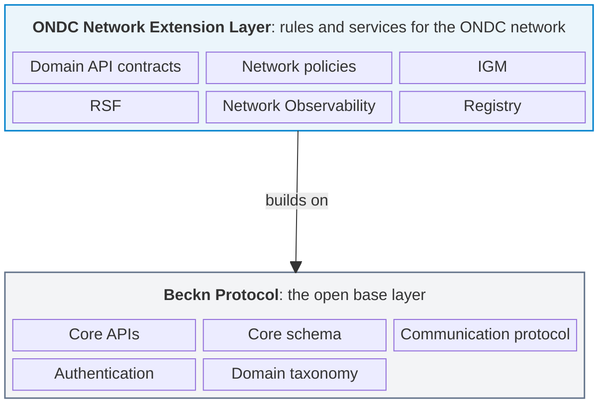
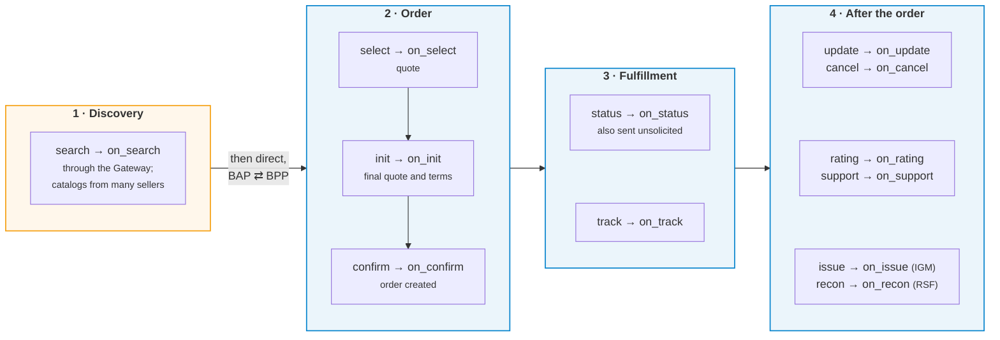
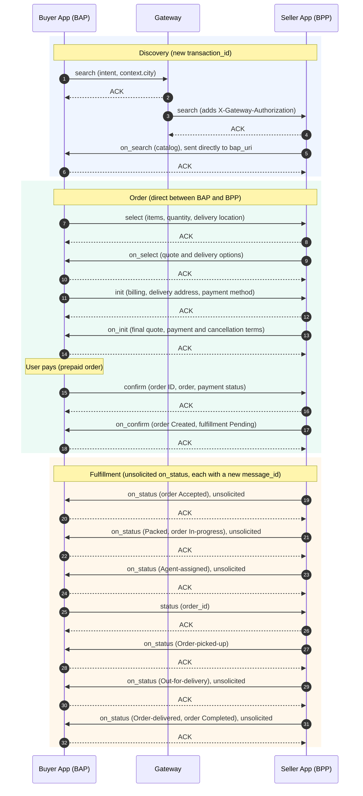
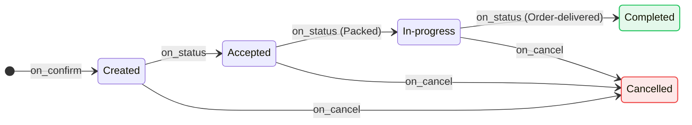
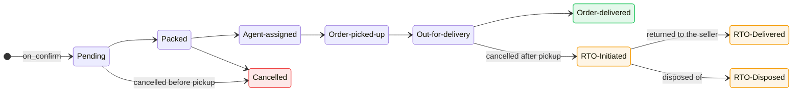
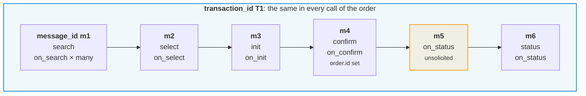
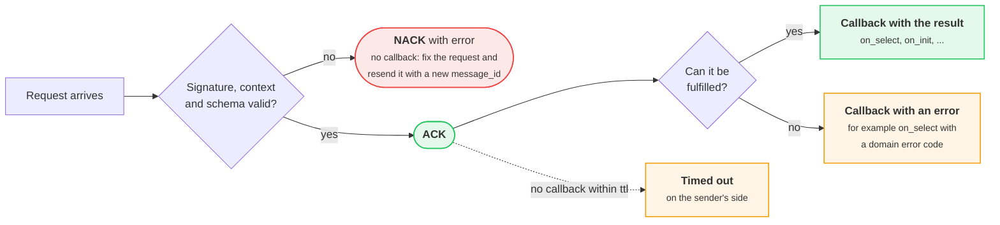
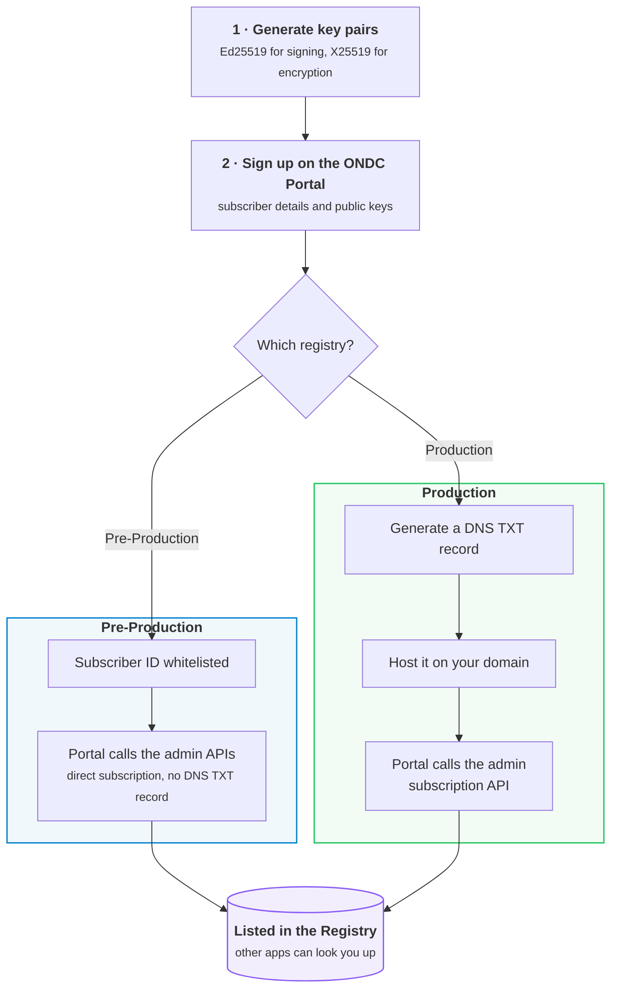
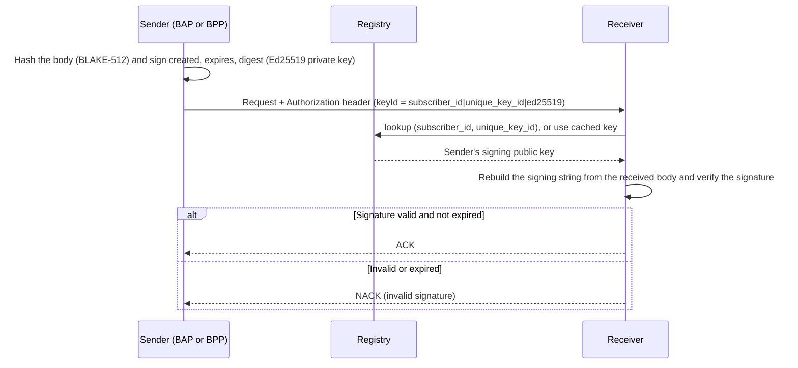

# The Protocol

**[Beckn](https://www.youtube.com/watch?v=gefmygtzZR8&t=1s)** is an open protocol that allows local businesses across any industry to be discovered and engaged by any beckn-enabled application. **Beckn protocol** is a collection of open specifications consisting of protocol APIs, message formats, network design and reference architectures to allow any two entities to execute commercial transactions without being on the same platform.

**ONDC** has provided the network extension layer over the Beckn Protocol (base layer). Over the base layer, the network extension layer comprises **model specifications** customised to the ONDC context that have been adopted in order to facilitate transactions over the network. For a detailed understanding of the ONDC network architecture, please refer to our [Video](https://drive.google.com/file/d/1WuHCc59C45LClpbiIPomPMuTeClRZw7h/view).

### Protocol Architecture

#### The Two-Layer Model

ONDC's protocol is structured as two distinct layers:

#### Beckn Protocol — The Base Layer

[Beckn](https://becknprotocol.io/) is an open-source, domain-agnostic protocol for decentralized commerce. It defines:

- **Core APIs** — Transaction APIs modeled after the order lifecycle (`search`, `select`, `init`, `confirm`, `status`, `track`, `update`, `cancel`) and their corresponding callbacks (`on_search`, `on_select`, etc.). There are also Supporting APIs for non-transactional operations like `rating` and `support`.
- **Core Schema** — The data model for commerce interactions, specified using OpenAPI 3.x. Defines objects like `Order`, `Item`, `Provider`, `Fulfillment`, `Payment`, `Billing`, etc.
- **Communication Protocol** — The rules governing how APIs are called (async, server-to-server, ACK-based).
- **Authentication** — How participants digitally sign and verify messages.
- **Domain Taxonomy** — A mechanism for adding industry-specific attributes to the core schema.

Beckn is **transport-layer-agnostic**. While HTTP is the most common implementation, the protocol itself doesn't mandate it.

#### ONDC Network Extension — The Upper Layer

ONDC builds on top of Beckn by adding:

- **Domain-specific API contracts** — Customized schemas and flows for retail, logistics, mobility, financial services, etc.
- **Network policies** — Rules around settlement, grievance management, compliance.
- **IGM (Issue & Grievance Management)** — APIs for raising and resolving issues (`issue`, `on_issue`, `issue_status`, `on_issue_status`).
- **RSF (Reconciliation & Settlement Framework)** — APIs for financial reconciliation between NPs (`recon`, `on_recon`, `settle`, `on_settle`).
- **Network Observability (NO)** — A framework for pushing transaction logs to ONDC for monitoring network health.
- **Registry infrastructure** — ONDC-specific onboarding, environment management, and key exchange.

See [API Reference](/developer-guide/docs/api-reference) for every API endpoint and its payload.

### How a Transaction Works

#### The Ground Rules

Every transaction on ONDC follows the same rules, whatever the domain:

- **Server-to-server:** the buyer app's backend (BAP) talks to the seller app's backend (BPP). The user's phone or browser never calls the network directly.
- **Asynchronous:** every request gets an immediate HTTP response, `ACK` (accepted) or `NACK` (rejected). The actual result comes later, as a separate request back to the sender, called a **callback**. Its name is the request's name with an `on_` prefix: `select` is answered by `on_select`.
- **Signed:** every request and callback carries an `Authorization` header signed by the sender. The receiver checks it against the sender's public key in the Registry before doing anything else.
- **Tracked:** every call carries a `context` with the same `transaction_id` for the whole transaction, and a `message_id` that links each request to its callback.
- **Logged:** both apps push every request and response to ONDC's [Network Observability](/developer-guide/docs/network-observability) service.

#### The Transaction at a Glance

Every transaction moves through the same stages. Each box is a request and its callback.

#### One Order, Start to Finish

The walk-through below follows one Grocery order (`ONDC:RET10`), from search to delivery. Other domains use the same pattern, with their own steps and states; the use case's **API Walkthrough** under Explore by Domain shows the exact flow for each.

**Step 0 — Before the first call.** Both apps are registered in the ONDC Registry, with a subscriber ID, a subscriber URL and public keys. To call or verify another app, each one looks up the other's URL and public key in the Registry (and caches it).

**Step 1 — Search (BAP → Gateway → BPPs).** The user searches for "atta" in Bengaluru. The BAP creates a new `transaction_id` and a `message_id`, and sends `search` to the **Gateway** with `context.city: "std:080"` and the item, category or location in `message.intent`. The Gateway answers `ACK`, adds its own `X-Gateway-Authorization` signature, and forwards the `search` to every seller app registered for that domain and city. Each seller app checks both signatures and answers the Gateway with `ACK`.

**Step 2 — Catalogs (BPPs → BAP).** Each seller app with matching items sends `on_search` **directly to the BAP's** `bap_uri`, not through the Gateway. It carries the same `transaction_id` and `message_id`, its own `bpp_id` and `bpp_uri`, and its catalog in `message.catalog`. The BAP answers each one with `ACK` and shows the merged results to the user. From now on the BAP knows which seller app to talk to, and every call goes **directly** between the two apps.

**Step 3 — Select (BAP → BPP).** The user adds items to the cart. The BAP sends `select` to the chosen seller app's `bpp_uri`, with a **new** `message_id`, the provider, items and quantities, and the delivery location. The seller app answers `ACK`, then sends `on_select` with the same `message_id`: a **quote** with the price breakup (items, delivery, packing, taxes) and the delivery options available.

**Step 4 — Init (BAP → BPP).** The user checks out. The BAP sends `init` with the billing details, the delivery address and contact, and the payment method. The seller app answers with `on_init`: the final quote, the payment terms (who collects the payment, settlement details), and the cancellation terms.

**Step 5 — Payment.** For a prepaid order collected by the buyer app, the user now pays inside the BAP. For cash on delivery, nothing is paid yet.

**Step 6 — Confirm (BAP → BPP).** The BAP sends `confirm` with the order ID, the full order, and the payment status and transaction reference. The seller app answers with `on_confirm`: the order in state **`Created`**, with its fulfillment in state **`Pending`**. The order now exists on both sides.

**Step 7 — Fulfillment updates (BPP → BAP, unsolicited).** As the order moves, the seller app sends `on_status` **without being asked**, each time with a new `message_id` and the same `transaction_id`. First the seller accepts the order (order **`Accepted`**). Then the fulfillment moves through **`Packed`**, **`Agent-assigned`**, **`Order-picked-up`** and **`Out-for-delivery`** while the order is **`In-progress`**, and finally **`Order-delivered`**, when the order becomes **`Completed`**. See [Order and Fulfillment States](#order-and-fulfillment-states). At any time the BAP can also ask with `status` → `on_status`, or get live tracking with `track` → `on_track`.

**Step 8 — Changes after the order.** If the order changes, the same pattern applies:

- The buyer cancels: `cancel` → `on_cancel`, with a reason code; the seller app returns the cancelled order and any refund.
- The seller app cancels, for example when an item is out of stock: it sends `on_cancel` unsolicited.
- A return, a partial cancellation or a change of address: `update` → `on_update`, and the seller app may later send unsolicited `on_update` calls as the change progresses.

**Step 9 — After delivery.** The user can rate the order (`rating` → `on_rating`) or ask for support (`support` → `on_support`). If something went wrong, the BAP raises an issue (`issue` → `on_issue`) and follows it until it is resolved and closed; see Issue and Grievance Management in the [API Reference](/developer-guide/docs/api-reference).

**Step 10 — Settlement.** The app that collected the payment settles with the other according to the terms agreed in `on_init`. Where the Reconciliation and Settlement Framework applies, the apps reconcile with `recon` → `on_recon`.

#### The Whole Flow

The diagram shows every call from `search` to the last `on_status` of one order, with the synchronous `ACK` for each. Solid arrows are requests and callbacks; dashed arrows are the `ACK` responses.

- Every request and callback is signed with an `Authorization` header and carries the same `transaction_id`.
- A request and its callback share a `message_id` (for example `select` and `on_select`, or `status` and the `on_status` that answers it). Each unsolicited `on_status` has a new one.
- The Gateway takes part only in `search`. Every call after `on_search` goes directly between the two apps.
- The other post-order calls (`track`, `update`, `cancel`, `rating`, `support`, `issue`) follow the same request, `ACK`, callback pattern.

#### Order and Fulfillment States

An order has two states that move together: the **order** state (`order.state`) and the state of each **fulfillment** (`fulfillments[].state.descriptor.code`). The diagrams show them for a delivery order in Retail (`ONDC:RET10` 1.2.5); other domains use their own values, listed in each use case's API Walkthrough.

**Order state:**

**Fulfillment state** (delivery):

| Stage | Sent in | Order state | Fulfillment state |
| --- | --- | --- | --- |
| Order placed | `on_confirm` | `Created` | `Pending` |
| Seller accepts the order | `on_status` | `Accepted` | `Pending` |
| Packed, agent assigned, picked up, on the way | `on_status` | `In-progress` | `Packed` → `Agent-assigned` → `Order-picked-up` → `Out-for-delivery` |
| Delivered | `on_status` | `Completed` | `Order-delivered` |
| Cancelled | `on_cancel`, then `on_status` | `Cancelled` | `Cancelled`; after pickup, `RTO-Initiated` → `RTO-Delivered` or `RTO-Disposed` (return to origin) |

#### Identifiers Through the Transaction

A request and its callback share one `message_id`; an unsolicited callback gets its own. `bpp_id` and `bpp_uri` are known from `on_search` onwards.

| Identifier | Created by | Stays the same |
| --- | --- | --- |
| `transaction_id` | BAP, on `search` | In every call of the transaction, from `search` to the last post-order call. |
| `message_id` | The sender of each request | Between a request and its callback (`select` and `on_select`). Each unsolicited `on_status`, `on_update` or `on_cancel` has a new one. |
| `bpp_id`, `bpp_uri` | BPP, in `on_search` | In every call with that seller app after `on_search`. |
| Order ID | Set in `confirm` | In every post-order call, as `order.id` or `order_id`. |

#### When Something Goes Wrong

| Situation | What Happens |
| --- | --- |
| The request is invalid (bad signature, wrong `context`, schema error) | The receiver answers `NACK` with an `error`. There is **no** callback; the sender must fix the request and send it again with a new `message_id`. |
| The request is valid, but cannot be fulfilled (for example, an item is out of stock) | The receiver answers `ACK`, then sends the callback with an `error` (for example `on_select` with a domain error code). |
| No callback arrives within the request's `ttl` | The sender treats the request as timed out. |

See [Core Error Codes](/developer-guide/docs/error-codes) for the error codes.

### Start your ONDC journey

Sign up or sign in on the [ONDC Portal](https://portal.ondc.org) to register as a Network Participant and begin your ONDC journey.

### Subscription Process

To enroll in the ONDC network, Network Participants (NP) must be added to the registry. The steps for an NP to onboard onto the ONDC Registry (Pre-Production, Production) are outlined as follows:

#### 1. Pre-Production Registry
- Obtain whitelisting for the subscriber ID.
- NP Portal invokes Admin APIs
- Keys are not validated upfront
- Direct subscription allowed
- DNS TXT record NOT required

#### 2. Production Registry
Participants will have to:
1. Generate DNS TXT record
2. Host DNS record
3. Portal will call admin subscription API

> **Note:** Steps involving DNS TXT record apply only to the Production environment. Pre-Production supports direct subscription without DNS validation.

### Signing and Verification

When communicating over HTTP using Beckn APIs, the subscribers need to authenticate themselves to perform transactions with other subscribers. Due to the commercial nature of the transactions, every request/callback pair is considered to be a "contract" between two parties. Therefore, it is imperative that all requests and callbacks are digitally signed by the sender and subsequently verified by the receiver.

How every request is signed and checked:

Use the [Signing & Verification](/developer-guide/auth-tools) tab to create and verify headers, with the header format and reference code.

---

## Terminology

| Term | Definition |
| ---- | ---------- |
| **Beckn Protocol** | Open-source, decentralized commerce protocol providing core specifications, message formats, and transaction APIs. |
| **ONDC Network Extension Layer** | Domain-specific API contracts, policies, and network rules configured on top of the Beckn Protocol base layer. |
| **Network Participant (NP)** | Any registered entity (buyer application, seller application, or gateway) on the ONDC network. |
| **Registry** | Central trust repository storing participant metadata, public keys, subscriber IDs, and callback URLs. |
| **Pre-Production Registry** | Testing and staging registry environment allowing direct subscription without DNS ownership validation. |
| **Production Registry** | Live registry environment that requires DNS TXT record verification and portal administration to enroll participants. |
| **Subscriber ID** | Unique FQDN-based identifier assigned to an NP to identify its transactions on the network. |
| **DNS TXT Record** | Domain Name System text record hosted on the participant's domain to verify ownership during production onboarding. |
| **Signing and Verification** | Cryptographic authentication where HTTP requests and callbacks are digitally signed by the sender and validated by the receiver. |
| **Subscriber** | A registered network participant authorized to transact on the ONDC network using verified keys and endpoints. |
